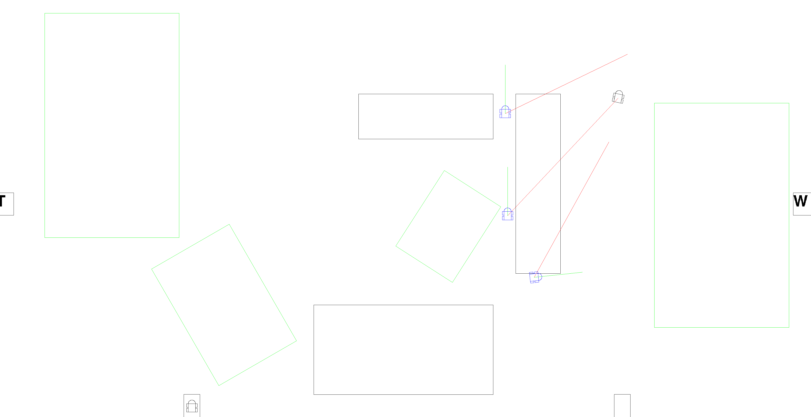
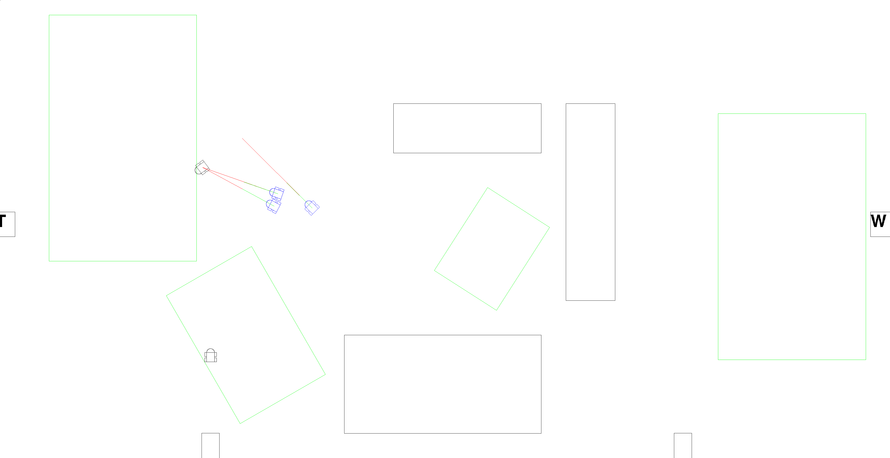

# Car
Car is a game for two players. Each player has to drive a car.

## Keys

 Player 1        | Player 2        | Function               |
 :---------------|:----------------|:-----------------------|
 Curser-Up       | W               | Forward-Acceleration   |
 Curser-Down     | S               | Backward-Acceleration  |
 Curser-Left     | A               | Left-Turn              |
 Curser-Right    | D               | Right-Turn             |
 RShift          | LShift          | Brake                  |
 Return          | LCtr            | begin/end tunnel       |
 RAlt            | LAlt            | begin/end to fuel^     |
 RAlt            | LAlt            | begin/end to repair^^  |

^  only at the fuel station;
^^ only at the repair station;

## Rules

### Speed
#### Global Speed Limit
Don't violate the speed limit, otherwise the car will be hunted of one police car after 10 sec driving 10% above the limit.
The speed limit changes every minute.
 
#### Speed Status: Smiley
- If the car velocity is under the speed limit the face will become: `:-)`.
- If your car's velocity exceeds the speed limit but is still within the 10% tolerance, the face will become `:-|`.
- If the car velocity exceeds the speed limit and tolerance the face will become `:-(`.

#### Car Speed
- If the car stands for 30 sec, it loses a life.
- The car has a maximum velocity (at beginning 240 km/h).
- If the car is faster than the maximum velocity, the car loses stability.
- The car maximum speed is relative to the stability:
      
  ~~~~~~~~~~~~~~~~~~~~~~~~~~~~~~~~~~~~~~~~~~~~~~~~~~~~~~~~~~~~~~~~~~~~~~~~~~~~~~~~~~~~~~{.sh}
  m_state.stability = std::min((m_state.stability / max_stability) * 500_km_h, 240_km_h)
  ~~~~~~~~~~~~~~~~~~~~~~~~~~~~~~~~~~~~~~~~~~~~~~~~~~~~~~~~~~~~~~~~~~~~~~~~~~~~~~~~~~~~~~

  - The car maximum velocity has the maximum worth 240 km/h.
  - The car maximum velocity is the smaller worth of stability / max_stability * 500 km/h and 240 km/h.
That`s why, the car maximum velocity is the stability in procent (max is 100%, min 0%) multiplicated with 500 km/h, but if this worth is over 240 km/h,
the smaller worth is 240 km/h, else the other worth.

### Fuel
- the car has to go to the gas station to maintain its fuel, if the fuel is short
- if the car refules, the player loses money (per liter, the car loses the fuel price)
- if the tank is empty and the car stands for 10 seconds, it loses a life.
- if the tank is empty, the car can fill the tank up with his fuel can, which have, if it is full, 5 liter.
- if the car is refueling and it drives out of the gas station, it stops to refueling
- if the fuel can have less fuel than the maximum and the car is refueling, the fuel can will be refuels at first
- at beginning, the fuel can and the tank are full
- the gas station is marked with a `T`
  
### Stability
- if the car intersects with an other thing (e.g. the other car), the stability falls
- if the stability equals zero, the car lose one life
- the car can go to the repair station to repair itself
- if the car will be repair, the player loses money
- if the car wants to repair super much, that the stability is over the maximum stability,
the car gets a life, and the stability will set on zero
  
  ~~~~~~~~~~~~~~~~~~~~~~~~~~~~~~~~~~~~~~~~~~~~~~~~~~~~~~~~~~~~~~~~{.sh}
  if(m_state.stability > max_stability){
      ++m_state.life;
      m_state.stability = m_state.stability - max_stability;
  }
  ~~~~~~~~~~~~~~~~~~~~~~~~~~~~~~~~~~~~~~~~~~~~~~~~~~~~~~~~~~~~~~~~

- a car can brake one second per brake-period, else the car lose stability.
- the repair station is marked with a `R`

### Lifes
- at the start every player has three cars or the lifes will be commited of the arguments with -lifes [[uint8_t](https://en.cppreference.com/cpp/types/integer)]
- if the lifes under zero, the car is exploded
  `bool is_car_exploded(){ return m_state.life <= 0; }`
  - and if the car is exploded it won't be draw
  
  ~~~~~~~~~~~~~{.sh}
  void draw(){
      ...
      if(is_car_exploded()){
          return;
      }
      ...
  }
  ~~~~~~~~~~~~~

- the number of lifes will be decreased if the stability is zero(look at Stability) or you aren't on the perking place after parking mode (see at Mode: Park)

### Tunnel
- one car can makes tunnels for 10 minute
- if the car makes a tunnel, the car gets money
- if a car drives on a tunnel (a circel with it index under it) the car is in the tunnel:
Than you see, that the car does not moves and the car is gray. If you accelerate, the car drives through the tunnel, but you do not see it.
The car will go out of the tunnel(at the other circle with same index) with the angle you see it and you can rotate the car while it is in a tunnel.
If you drives backwards, the car comes at the same position out as it went in.
- a car only can make a tunnel begin/end on the green rectangles

### Money
- you lose money while refueling and repairing.
- you lose money if a police car catch you (see police car).

### Mode: Park
- speed limit will be equals 50 km/h.
- the car have to go to the parking place.
- at the end of the mode, the car must be on it parking place, else it lose a life.

### Police car
- a police car hunts a car, if the car collide on a house (black rectangles) or if the car drove 10 sec over 110% of the speed limit (100% + 10% <- tolerance).
- the police car remebers the punishment, of the car:
  - if the car drove too fast:
      
  ~~~~~~~~~~~~~~~~~~~~~~~~~~~~~~~~~~~~~~~~~~~~~~~~~~~~~~~~~~~~~~~~~~~~~~~~~~{.sh}
  const float punish = (std::abs(m_velocity) - max_velo)*10;
  ~~~~~~~~~~~~~~~~~~~~~~~~~~~~~~~~~~~~~~~~~~~~~~~~~~~~~~~~~~~~~~~~~~~~~~~~~~~~~~~
    
  - so the punish is the difference of absolut velocity and speed limit.
  - if the car collide with a house:
      
  ~~~~~~~~~~~~~~~~~~~~~~~~~~~~~~~~~~~~~~~~~~~~~~~~~~~~~~~~~{.sh}
  const float punish = std::abs(m_velocity * 15);
  ~~~~~~~~~~~~~~~~~~~~~~~~~~~~~~~~~~~~~~~~~~~~~~~~~~~~~~~~~~~~~~~
      
  - so the punish is the absolute velocity multiplicated with 15.
- the police car drives under the speed limit, exept:
  
  ~~~~~~~~~~~~~~~~~~~~~~~~~~~~~~~~~~~~~~~~~~~~~~~~~~~~~~~~~~~~~~~~~~~~~~~~~~~~~~~~~~~~~~~~~~~~~~~~~~~~~~~~~~{.sh}
  if(m_target->m_punish < 1000) {
      addToVelocity(std::min({accel, m_state.max_car_velo - m_velocity, max_velo*0.9f - m_velocity}), dt);
  } else if(m_target->m_punish < 5000) {
      addToVelocity(std::min({accel, m_state.max_car_velo - m_velocity, max_velo*2.0f - m_velocity}), dt);
  } else {
    addToVelocity(std::min(accel, m_state.max_car_velo - m_velocity), dt);
  }
  ~~~~~~~~~~~~~~~~~~~~~~~~~~~~~~~~~~~~~~~~~~~~~~~~~~~~~~~~~~~~~~~~~~~~~~~~~~~~~~~~~~~~~~~~~~~~~~~~~~~~~~~~~~~~~~~~
    
  - if the total punish of the target (of the police car hunted car) is over 1000$ and under 5000$, the police car will drive under 2 * speed limit.
  - if the total punish of the target is over 5000$, the police car has only the speed limit maximum velocity of it.
  - but in all cases, the police car will drive not over its maximum velocity.
- if a car collide with a house, three police cars comes:
  - one car has its target befor the targetted car
  - another car has its target exactly on the targetted car
  - the third car has its target behind the targetted car
  
  ~~~~~~~~~~~~~~~~~~~~~~~~~~~~~~~~~~~~~~~~~~~~~~~~~~~~~~~~~~~~~~~~~~~~~~~~~~~~~~~~~~~~~~~~~~~~~~~~~~~~~~~~~~~~~~~~~~~~~~~~~~~{.sh}
  point_t get_target_point() {
      switch (m_id) {
          case car_id_3: {
              return m_target->m_rect_body.p_center;
          }
          case car_id_4: {
              return m_target->m_rect_body.p_center + vec_t::from_length_angle( 10_m, m_target->m_angle);
          }
          case car_id_5: {
              return m_target->m_rect_body.p_center + vec_t::from_length_angle(-10_m, m_target->m_angle);
          }
          default: break;
      }
      return {0, 0};
  }
  ~~~~~~~~~~~~~~~~~~~~~~~~~~~~~~~~~~~~~~~~~~~~~~~~~~~~~~~~~~~~~~~~~~~~~~~~~~~~~~~~~~~~~~~~~~~~~~~~~~~~~~~~~~~~~~~~~~~~~~~~~~~~~~~~~~
  
  - a example:
  
  {width=50%}

  - the red lines shows the difference (center to target point)
  - the green lines shows the velocity vector of police car
  
  - another example:
  
  {width=50%}
  
  - here have two police car the same target point (exactly on the car)
- (perspective of a police car) if no police car with the next id has less than the threefold difference to the targetted car as I or I reached my target point, I get the next id
  
  ~~~~~~~~~~~~~~~~~~~~~~~~~~~~~~~~~~~~~~~~~~~~~~~~~~~~~~~~~~~~~~~~~~~~~~~~~~~~~~~~~~~~~~~~~~~~~~~~~~~~~~~~~~~~~~~~~~~~~~~~~~~~~~~~~~~~~~~~~~~{.sh}
  const int next_id = m_id < car_id_5 ? m_id + 1 : car_id_3;
  if(m_id > car_id_3) {
      if(m_aabbox.contains(target_point) && !m_target->m_state.digging_tunnel && !m_target->m_state.inTunnel) {
          if(debug_prt) {
              printf("Car %d -> %d!\n", m_id, next_id);
          }
          m_id = next_id;
          return true;
      }
      bool go_one_id_over = true;
      for(const Car_ref& AI_car : AI_cars) {
          if(AI_car && m_target == AI_car->m_target && ((AI_car->m_id == next_id) || std::abs((AI_car->m_rect_body.p_center - m_target->m_rect_body.p_center).length()) * 3 <
              std::abs((m_rect_body.p_center - m_target->m_rect_body.p_center).length()))) {
              go_one_id_over = false;
              break;
          }
      }
      if(go_one_id_over) {
          m_id = next_id;
      }
  }
  ~~~~~~~~~~~~~~~~~~~~~~~~~~~~~~~~~~~~~~~~~~~~~~~~~~~~~~~~~~~~~~~~~~~~~~~~~~~~~~~~~~~~~~~~~~~~~~~~~~~~~~~~~~~~~~~~~~~~~~~~~~~~~~~~~~~~~~~~~~~~~~~~~

- (perspective of a police car) if the penalty is over 100, I divide it through 3 and call a new police car to catch the targetted car with the next id

  ~~~~~~~~~~~~~~~~~~~~~~~~~~~~~~~~~~~~~~~~~~~~~~{.sh}
  const int next_id = m_id < car_id_5 ? m_id + 1 : car_id_3;
  if(m_punish > 100) {
      m_punish /= 3;
      make_police_car(next_id, m_punish*2, m_target);
  }
  ~~~~~~~~~~~~~~~~~~~~~~~~~~~~~~~~~~~~~~~~~~~~~~~~~~~

  - and the penalty of the new police car is than the double of my penalty
  
